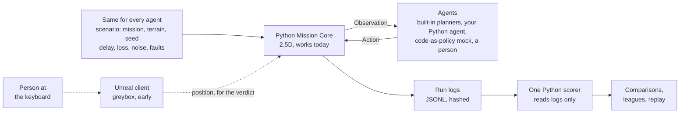

# Roverloom

Roverloom is a simulation and benchmarking platform for autonomous rover agents.

It runs different agents on the same missions, terrain, communication delay and loss, injected
faults, and scoring rules, and compares them from their logs alone.


*Concept render (vork), not a game screenshot. The V2 rover model from this repository in an invented,
Mars-inspired scene, rendered offline. This look is not yet in the Unreal client; the game today is the greybox
shown below. [How it was made](docs/results/concept-renders/README.md).*

> **Status: pre-alpha.** The Python Mission Core, rover builder, agent SDK, offline leagues,
> scoring, replay, and a 2D Mission Control work today. An Unreal Engine client is in early
> development: a greybox rover that a person drives by keyboard, while the Python Mission Core
> judges the mission. **Python agents do not yet drive the Unreal rover.** No language model is
> connected; the code-as-policy interface runs only with a rule-based mock. The online
> competition does not exist yet.
>
> The rover, soil, power, sensor, and event models are simple approximations for games and early
> research. They have not been validated against real rovers or terramechanics.


*Game screenshot: Unreal Engine 5.8.4 on a Mac mini, 2026-11-08 ([run record](docs/results/g4a-manual/README.md)).
A person drove to the target by keyboard; the Python Mission Core judged success at 57.1 s, and
Unreal only shows the verdict. Engine basic shapes on flat test ground, no terrain data, and a
provisional drive model that is not validated.*

## How a comparison works



Solid lines work today. Dotted lines are the Unreal link as it stands: a person drives the Unreal
rover, and the Mission Core judges one reach-target mission from its position. Python agents
cannot drive the Unreal rover yet, and Unreal runs are not scored.

## What is held equal between agents

| Same for every agent | How |
| --- | --- |
| Missions and terrain | Scenario files in `scenarios/`; benchmark inputs are hash-pinned |
| Communication delay, loss, and noise | Seeded, defined per scenario |
| Faults and environment events | Seeded, labeled `mars_inspired` or `stress_test` |
| What an agent sees | Only `MissionBrief` and `Observation`, never the scenario or the true rover state |
| Scoring | One Python scorer, which reads log files only |

Results compare agents on these scenarios and this game model. They say nothing about real
rovers, and results from different backends are never compared.


*The 2D Mission Control, where the full mission loop with agents, faults, and scoring runs today.
The terrain is generated rather than real.*

## Quick start

Requires [uv](https://docs.astral.sh/uv/). A browser is needed only for viewing.

```shell
git clone https://github.com/SayokoAkiike/Roverloom.git
cd Roverloom/python
uv run roverloom demo
```

This runs sample missions with four agents, prints a score table, and writes
`runs/demo/report.html`, which you can open in a browser to replay every run.

Drive the rover yourself, or hand over to an agent with `M`:

```shell
uv run roverloom play
```

## Common commands

Run these from `python/`.

| Command | Purpose |
| --- | --- |
| `uv run roverloom demo` | Run all practice scenarios, and write a report |
| `uv run roverloom play --scenario boulder_gap` | Drive manually in a browser |
| `uv run roverloom run --agent replanner --seed 3` | Run one mission, and save its logs |
| `uv run roverloom run --agent examples/my_agent.py:CautiousAgent` | Run your own agent |
| `uv run roverloom compare --agents waypoint,replanner --seeds 1,2,3` | Compare agents |
| `uv run roverloom replay ../runs/demo/demo_traverse/replanner/seed-1 --at 200` | Check a run, and inspect its history |
| `uv run roverloom replay RUN_DIR --html view.html` | Write a replay viewer for one run |
| `uv run roverloom score RUN_DIR` | Recompute the score from logs only |
| `uv run roverloom benchmark` | Measure simulation speed on this machine |
| `uv run roverloom rover` | Compare rover designs and budgets |
| `uv run roverloom rover scout_4w --explain` | Show a design's budgets, and what each part does |
| `uv run roverloom design-study --workers 2` | Change one design choice at a time, and rerun the missions |
| `uv run roverloom study --workers 2` | Compare planners over four tracks, with intervals; about 35 minutes |
| `uv run roverloom run --scenario science_campaign --agent mission-planner --rover hauler_8w` | Run a science mission on a chosen rover |
| `uv run roverloom skills` | Print the skill contract |
| `uv run roverloom league run` | Run all offline leagues, with CSV, JSON, and leaderboards |
| `uv run roverloom competition examples/submission` | Run a local mock submission (not a sandbox) |

## What works today

| Capability | State | Details |
| --- | --- | --- |
| Mission simulation | Works | Fixed-step 2.5D model. See [models](docs/lightweight-models.md) |
| Rover Builder | Works | Classes, volume, power, part rules, and Pareto analysis. See [guide](docs/rover-builder.md) |
| Scientific study | Works | Four tracks, intervals, failure causes. See [benchmark](docs/scientific-benchmark.md) |
| Science missions | Works | Inspect, sample, send in data windows, return to base |
| Events, delay, loss, noise | Works | Eight event types, labeled as Mars-inspired or stress tests; seeded |
| Manual driving and agents | Works | The same command path for both |
| Agents and skills | Works | Reactive, classical, mission and adaptive planners, human approval, seven typed skills |
| CaP-ready interface | Mock only | Validated JSON skill calls. No real model is connected, and no code is executed |
| Offline leagues | Works | Autonomy, Rover Design, Full Mission; pinned benchmark, private seeds |
| Codabench-style evaluator | Local mock only | **Never run on Codabench**, and [not a sandbox](docs/evaluator-safety.md) |
| Logs, replay, scoring | Works | Tamper-evident JSONL; scored from files alone |
| Reproducibility | Tested | Identical logs for identical inputs on the same platform |
| Mission Control | Works locally | [Guide](docs/mission-control.md), tested in a real browser. No frontend framework |
| Agent-to-simulator bridge | Works on the lightweight backend | Loopback JSON Lines, protocol version 1 |
| Unreal contract | Specified and tested without Unreal | [Frames, units, time, safety](docs/unreal-contract.md) |
| Unreal rover, cameras, HUD | Greybox, on one Mac | Keyboard driving on a provisional, unvalidated drive model; four cameras; watchdog. See [game readiness](docs/results/game-readiness/README.md) |
| Unreal mission link | One scenario | The Mission Core judges one reach-target mission from Unreal's position. See [G3](docs/results/g3-mission-link/README.md), [G4a](docs/results/g4a-manual/README.md) |
| Python agents driving Unreal | **Not started** | Bridge protocol v1 is not implemented in C++ |
| Unreal terrain, faults, battery, run logs | **Not started** | Flat test ground only. A [Gale heightfield](docs/results/terrain-gale/README.md) from HiRISE is prepared, not imported. Unreal runs are not scored |
| Unreal MCP | Verified in a disposable project on one Mac | [Measured results](docs/unreal-mcp.md#measured-results) |
| Online competition | **Not started** | [Input and output draft](docs/competition-io.md) |

## Concept renders

**Concept render (vork), not a game screenshot.** The V2 rover model, generated by a script in this repository, in an
invented Mars-inspired scene rendered offline with [vork](https://github.com/voyager-so/vork). This look is not yet in
the Unreal client, and these images say nothing about physics or game performance. The hero image is at the
top of this page. [How they were made](docs/results/concept-renders/README.md).

| | |
| --- | --- |
|  |  |

## Add your own

- [Custom Rover Tutorial](docs/tutorials/custom-rover.md)
- [Custom Agent Tutorial](docs/tutorials/custom-agent.md)
- [Custom Mission Tutorial](docs/tutorials/custom-mission.md)
- [Custom Failure Model Tutorial](docs/tutorials/custom-failure-model.md)
- [Benchmark Reproduction Guide](docs/benchmark-reproduction.md)
- [Competition Rules Draft](docs/competition-rules.md)
- [API Compatibility Policy](docs/api-compatibility.md)
- [Scientific Benchmark](docs/scientific-benchmark.md)
- [Model Assumptions](docs/model-assumptions.md)
- [Handoff](docs/HANDOFF.md)
- [Project Status](docs/project-status.md)
- [Evaluator Safety](docs/evaluator-safety.md)
- [macOS Setup and Checklist](docs/macos-checklist.md)
- [Mac Unreal Plan](docs/mac-unreal-plan.md)
- [Product Quality Vision](docs/product-quality-vision.md) and [Release Gates](docs/release-gates.md), plans only
- [Visual Roadmap](docs/visual-roadmap.md), plan only
- [Concept Renders with vork](docs/vork-concept-renders.md), not game screenshots

## Repository layout

```text
python/      Mission core, agents, preview, and tests
schemas/     Backend-neutral contracts for messages, logs, and configuration
scenarios/   Practice and benchmark missions, terrain definitions
rovers/      Rover parameters and designs
benchmarks/  Pinned benchmark definitions
competition/ Draft Codabench bundle files and public reference data
unreal/      Unreal Engine C++ project: greybox rover, test ground, HUD
docs/        Design, decisions, plans, and guides
scripts/     Repository checks and preview capture
.github/     CI and templates
```

## Development

```shell
git lfs install --local
cd python
uv sync
uv run pytest
uv run ruff check . ../scripts
uv run ruff format --check . ../scripts
uv run mypy
uv run python ../scripts/check_repo.py
```

See [architecture](docs/architecture.md), [roadmap](docs/roadmap.md), and
[security notes](docs/security.md).

## Contributing

See [CONTRIBUTING.md](CONTRIBUTING.md). The project is not yet open to public contributions.

## License

No license has been selected yet, so no rights are granted to use, copy, or modify this
code. An open source license is planned before any public release; see
[licensing review](docs/licensing-review.md) and [assets and sources](docs/assets-and-sources.md).

Unreal Engine is a trademark of Epic Games, Inc. Roverloom is not affiliated with or endorsed
by Epic Games, NASA, or USGS.
